# ALU Market: Student Survival Marketplace

A Flutter and Firebase mobile app where ALU students buy, sell and chat about second-hand items on campus. Built with Clean Architecture and BLoC/Cubit. No `setState` is used for application state.

## Screenshots

All screenshots were taken on the Pixel 6a emulator in portrait.

### Main screens

| Login | Marketplace | Search | Create listing |
|---|---|---|---|
| 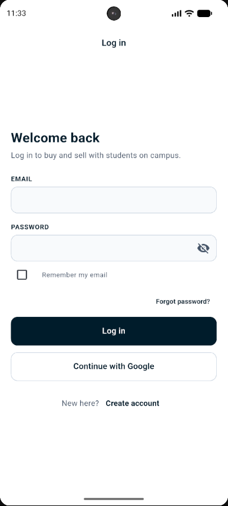 | 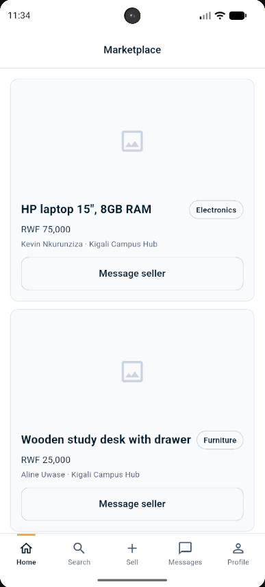 | 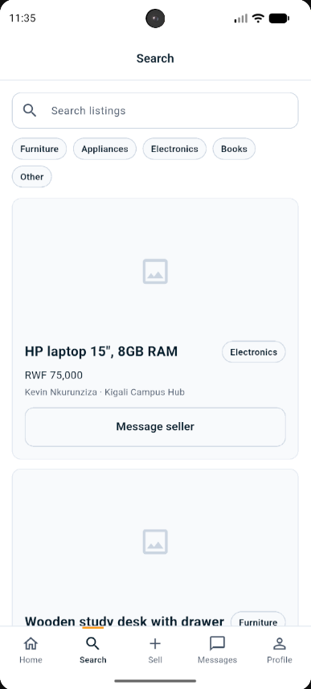 | 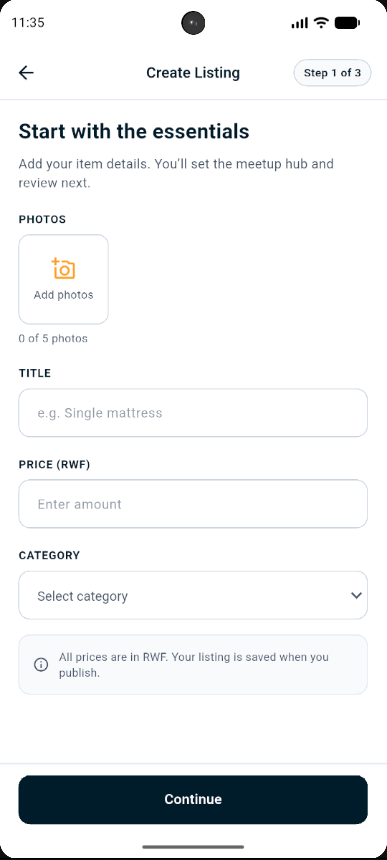 |

| Messages | Profile | Settings |
|---|---|---|
| 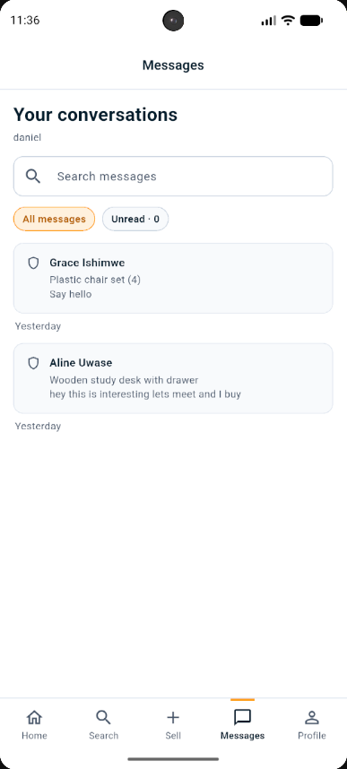 | 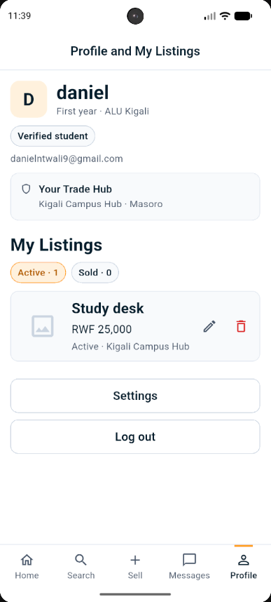 | 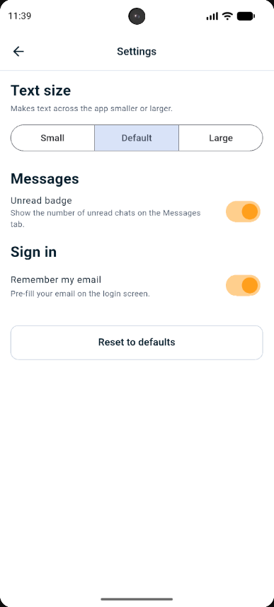 |

### Registration and email verification

After registration Firebase sends a verification email. Opening its link confirms the address.

| Create account | Verification email | Confirmation page |
|---|---|---|
| 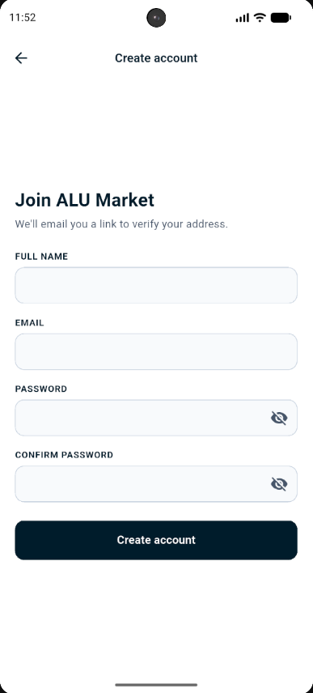 | 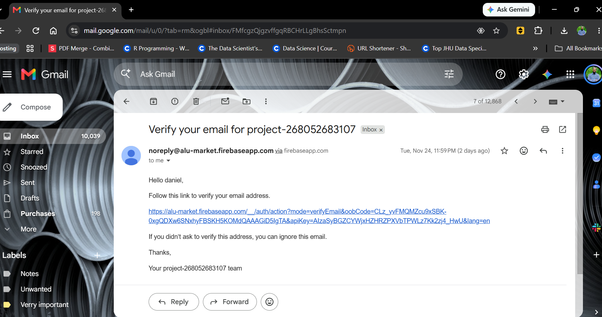 | 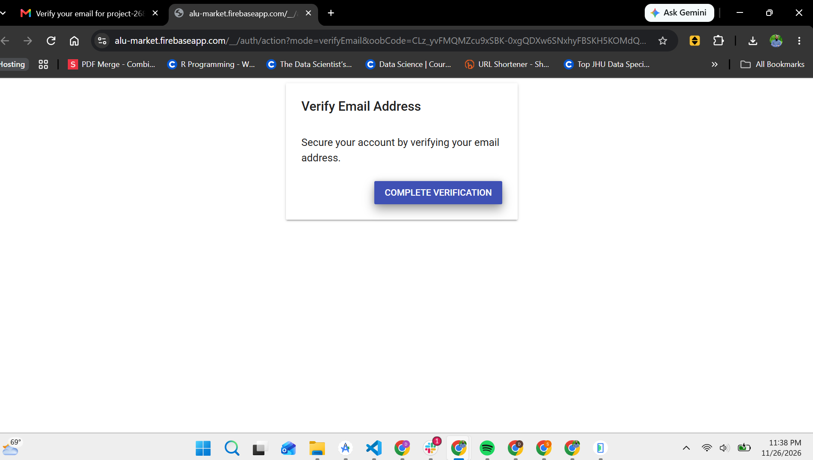 |

## Backend and test evidence

### Firestore data

The `listings` collection holds seeded demo documents (`demo-01` and onward) in the `alu-market` Firebase project. Each document stores category, createdAt, hub, imageUrl, photoCount, price, sellerId, sellerName, status and title.

| Collections and documents | All fields of one listing |
|---|---|
| 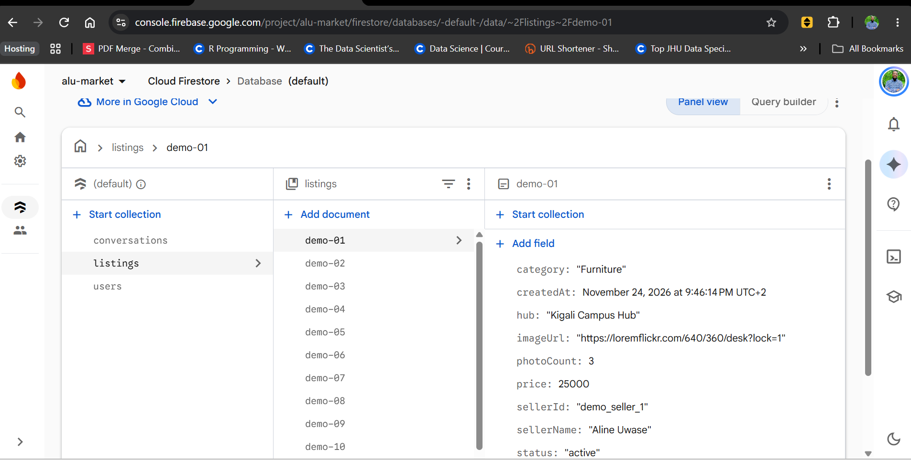 | 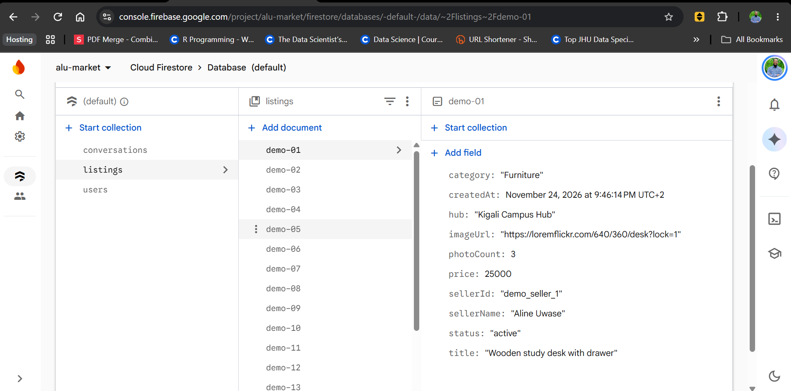 |

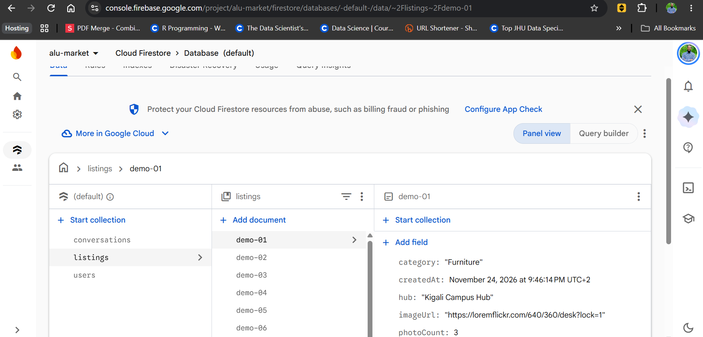

### Firebase usage

Firestore reads and writes recorded in the Firebase console after the demo data was seeded and the app was used.

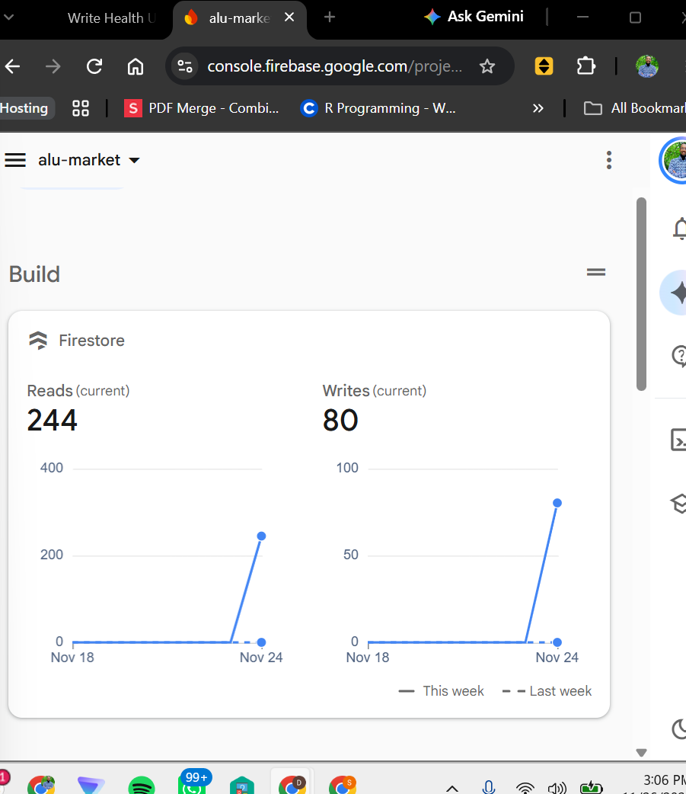

### Tests, analysis and coverage

`flutter test` and `flutter test --coverage` pass all 69 tests, and `flutter analyze` reports no issues.

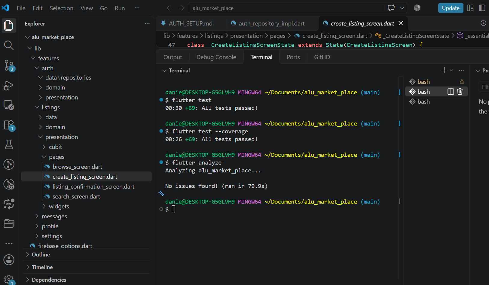

Overall line coverage is 49.6% (459 of 925 lines). The per-file breakdown below lists the files with the lowest coverage first.

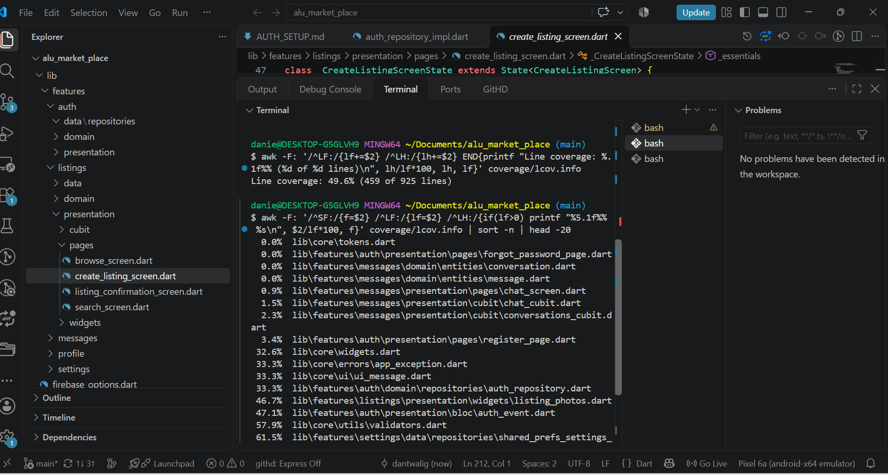

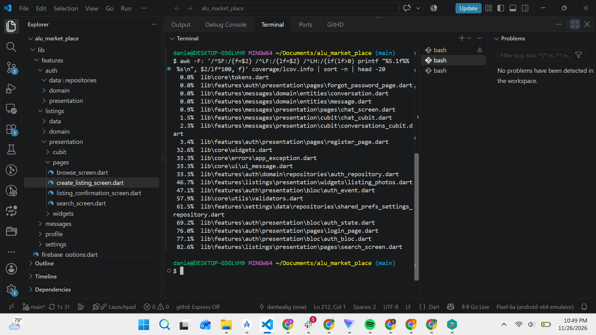

## Features

- **Authentication:** email and password (register, login, logout, password reset, email verification) and Google sign-in. The session is restored after a restart.
- **Listings (Firestore CRUD):** create (3-step flow), read (live), update (edit title and price), delete, and mark as sold.
- **Search:** filter other students' listings by text and category.
- **Messages:** real-time buyer and seller chat, confirm meetup, report user, and a No Internet screen.
- **Profile:** user document in Firestore, and the Trade Hub setting.
- **Settings (SharedPreferences):** text size, unread badge on the Messages tab, and remember my email. Saved on the device and restored on relaunch.

## Architecture

```
lib/
  core/            design tokens, shared widgets, validators, formatters, session binder
  features/
    auth/          domain / data / presentation (AuthBloc)
    listings/      domain / data / presentation (MyListings, Browse, Search, CreateListing cubits)
    messages/      domain / data / presentation (Conversations, Chat cubits)
    profile/       domain / data / presentation (Profile cubit)
    settings/      domain / data / presentation (SettingsCubit + SharedPreferences)
```

Each feature has three layers. The domain layer holds entities and repository interfaces. The data layer holds the Firebase and SharedPreferences implementations. The presentation layer holds the Bloc or Cubit and the screens. Screens only read state and send events, so business logic stays out of the UI files.

Other files: `firestore.rules`, `firebase.json`, `docs/ERD.md` and `docs/ERD.png`.

## Setup

Requirements: a recent stable Flutter SDK, an Android emulator or phone, and a Firebase project.

1. In the Firebase console create a project. Under Authentication, enable **Email/Password** and **Google**.
2. Register the Android app. The package name is `com.example.alu_market_place`.
3. Get your debug SHA-1 with `cd android && ./gradlew signingReport`, add it under Project settings, then download `google-services.json` into `android/app/`.
4. Create a Firestore database, then publish the rules: copy `firestore.rules` into Firestore, Rules, or run `firebase deploy --only firestore:rules`.
5. Run:

```
flutter pub get
flutter run
```

Run it on an emulator or a phone, not on Chrome. More detail is in `AUTH_SETUP.md`.

## Tests

```
flutter test --coverage
dart format .
flutter analyze
```

Test files are in `test/`: validators and formatters, `AuthBloc`, the settings, listing and search cubits, and widget tests for the login page and the search screen.

## Demo tips

- Use two accounts (two emulators, or log out and in). Account A posts a listing. Account B finds it in Marketplace or Search and taps "Message seller".
- Account A replies, taps "Confirm meetup", then "Mark as Sold".
