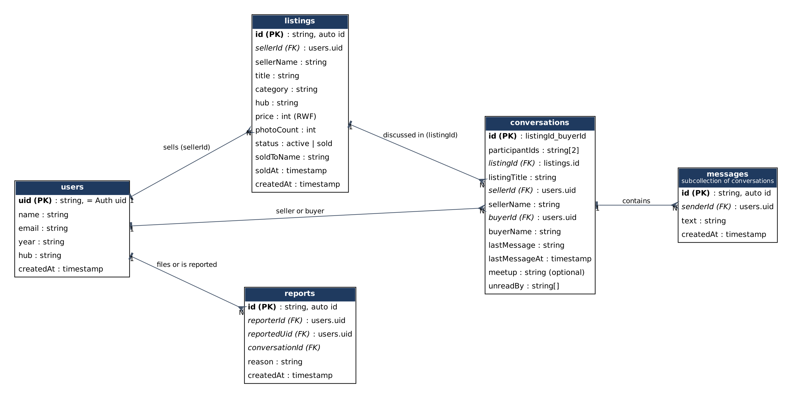
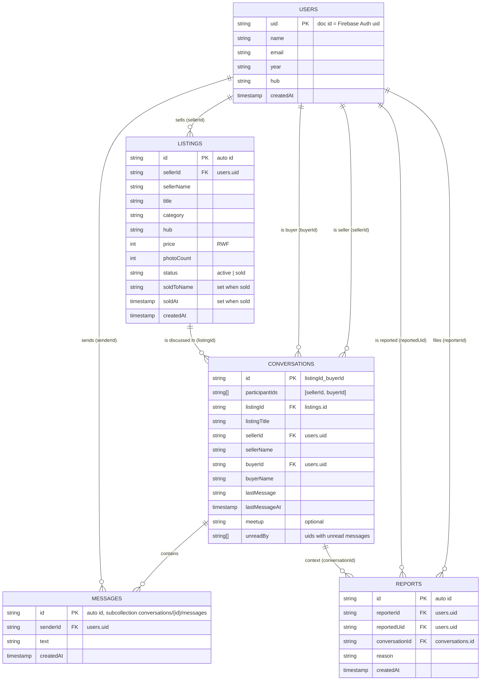

# ERD and Firestore mapping

Firestore is a document database, so each entity below is a collection (or a
subcollection) and each foreign key is a stored document id / uid.

## Intentional denormalisation
`sellerName`, `buyerName` and `listingTitle` are copied into `conversations`, and
`sellerName` into `listings`, so the inbox and the home feed render from a single
query without one extra read per row. They are written once at creation time.

## Indexes
No composite indexes are required: every query uses a single filter
(`sellerId ==`, `status ==`, `participantIds array-contains`) and results are sorted on the
device. `messages` are ordered by the single field `createdAt`, which is indexed automatically.
